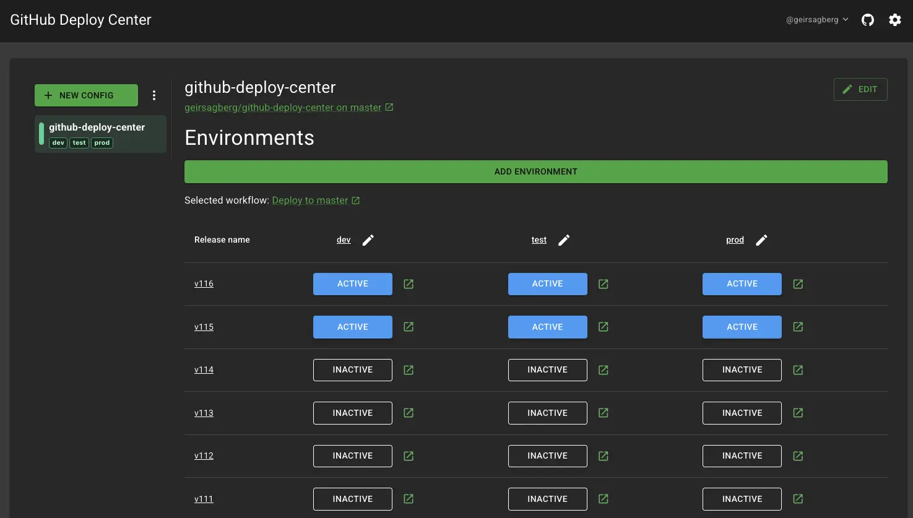

# GitHub Deploy Center (GDC)


GDC is a static website for showing your GitHub releases and deployments, and provides one-click deployment to any environment, powered by -your- GitHub Action workflows.



- GDC is a fully static website and stores configuration locally. Personal access tokens can be kept in local or session storage. No cookies, and nothing is sent to any server!
- Application settings can be exported, shared and imported.
- Monorepos are supported, with a flexible configuration flow for multiple applications in the same repo.

## Getting started

To use GDC, you need a couple of things:

- A GitHub Personal Access Token with the `repo` OAuth scope. You can create one [here](https://github.com/settings/tokens).
- A way to create GitHub releases (preferrably automatically, e.g. through GH Actions). See [the GDC Build and Publish workflow](./.github/workflows/build-and-publish.yml) as an example.
- A GitHub Workflow for **deployment** with the `workflow_dispatch` trigger.
  - The workflow must accept the following inputs (names are customizable):
    - `ref`: Which release version to deploy (e.g. v1.0.3)
    - `environment`: Which environment to deploy to (e.g. dev, test or prod)
  - The workflow must create a deployment for the same commit as the release, and update status on success or failure.
    - RECOMMENDED: If you create the deployment with the `payload` of `{"workflow_run_id": ${{ github.run_id }}}`, the deployment will be linked to the workflow run in the UI.
  - See [the GDC Deploy workflow](./.github/workflows/deploy.yml) as an example.
  - Follow [Deactivate previous deployments](#deactivate-previous-deployments) to keep deployment history up to date after each successful deployment.

## Deactivate previous deployments

GDC includes a reusable action that marks older successful deployments in the same repository and environment as inactive, including production deployments. It keeps the supplied deployment and any newer deployments active, and skips failed, pending, and already inactive deployments.

The action reads every page of deployment history and verifies that the supplied deployment is successful before changing any statuses. GDC runs it at the end of [its own deployment workflow](./.github/workflows/deploy.yml).

### Add it to your workflow

1. Grant the workflow `deployments: write` permission.
2. Give your deployment creation step an `id`, such as `create_deployment`, so you can reference its database ID.
3. Record a successful deployment status after your deployment finishes.
4. Add the cleanup action immediately after that status update. Keep its default success condition so it only runs when the preceding steps succeed.

This example shows where the action fits in an existing deployment job:

```yaml
permissions:
  contents: read
  deployments: write

jobs:
  deploy:
    runs-on: ubuntu-latest
    concurrency:
      group: deploy-${{ inputs.environment }}
      cancel-in-progress: false
    steps:
      # Your existing steps create the deployment, deploy the release,
      # and record the successful deployment status here.

      - name: Deactivate previous deployments
        uses: geirsagberg/github-deploy-center/actions/deactivate-previous-deployments@deactivate-previous-deployments-v1.0.0
        with:
          current-deployment-id: ${{ steps.create_deployment.outputs.deployment_id }}
```

The example assumes your workflow has an `environment` input and that the creation step exposes a `deployment_id` output. Adjust those references to match your workflow. Use the same concurrency group for all jobs that deploy to the same environment to prevent overlapping deployments and cleanup.

The action uses `${{ github.token }}` by default. To supply another token with deployment write permission, pass `token: ${{ secrets.DEPLOYMENT_TOKEN }}` under `with`. No checkout or dependency installation is needed when using the remote action. Action versions use tags such as `deactivate-previous-deployments-v1.0.0`, separate from GDC release tags. Pin the action to a commit SHA for reproducible workflows.

API errors fail the cleanup step. If an update fails partway through, earlier updates remain applied; rerunning cleanup skips deployments already marked inactive. See the [action reference](./actions/deactivate-previous-deployments/README.md) for its inputs and runtime requirements.

## Hosting

The app is hosted in Azure at https://githubdeploy.z1.web.core.windows.net/, and will be kept updated to the latest version. If you want to host it yourself, you can build it for production with `bun run build`, then host the resulting static assets in `dist/` anywhere you like, e.g. Azure Blob Storage, Heroku, Google Cloud Storage.

# Development

The app is built with:

- [Vite](https://vitejs.dev/)
- [Material UI](https://material-ui.com/)
- [Valtio](https://valtio.dev/)
- [React Query](https://@tanstack/react-query.tanstack.com/)
- [GraphQL](https://graphql.org/)

## Start locally

```
bun install
bun run start
```
